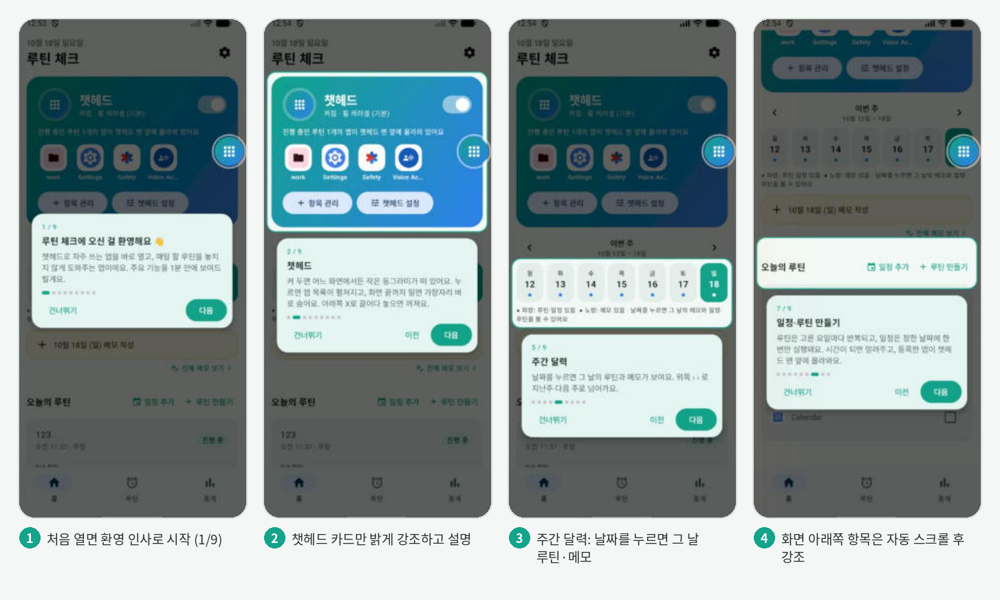
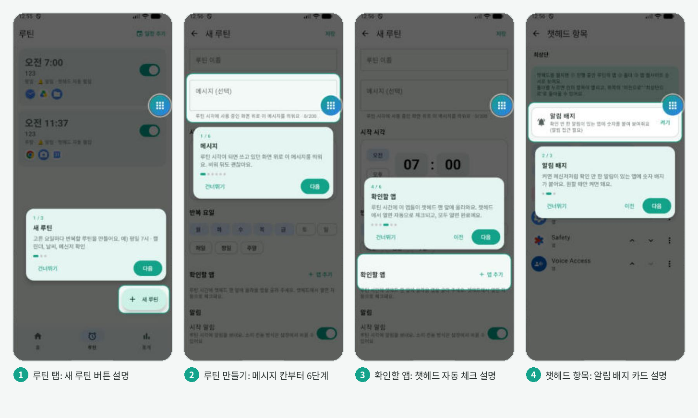
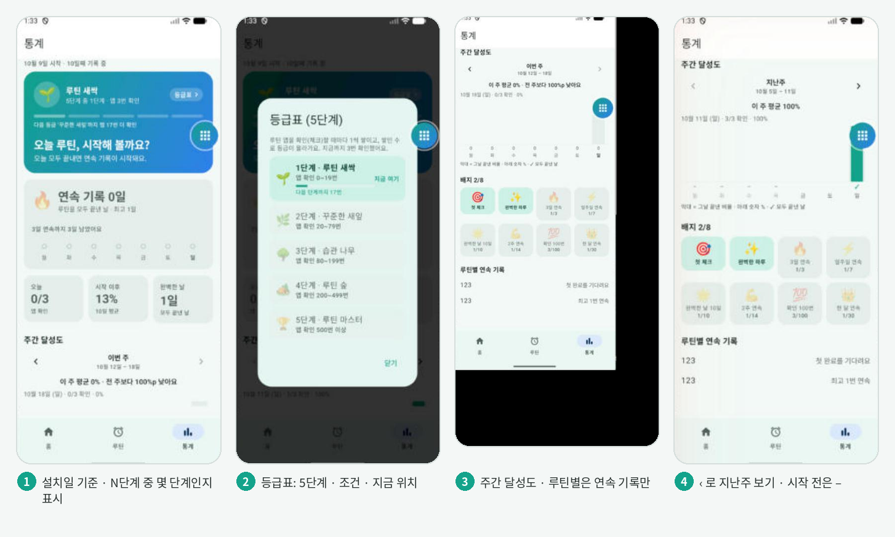
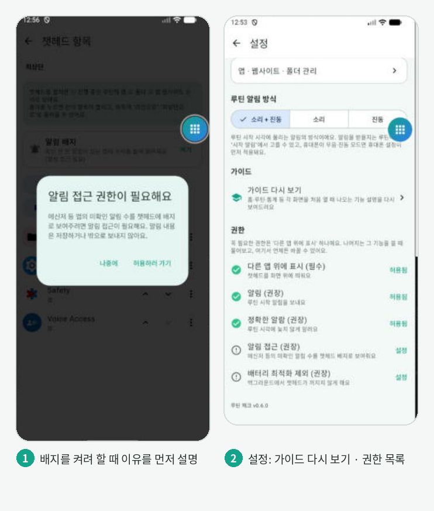

# 루틴 체크 어플 (v0.7.0)

안드로이드의 앱 접근 방식이 비효율적이라는 문제의식에서 시작한 앱입니다.
**화면 위 챗헤드 하나로 주요 앱·웹사이트를 바로 열고 확인**하는 것이 핵심이고,
루틴 · 알림 · 메모 · 통계는 챗헤드를 더 잘 쓰게 해주는 보조 기능입니다.

## 기능 요약

| 기능 | 내용 |
|---|---|
| 챗헤드 (핵심) | 원형 기본 → 화면 끝까지 밀면 가장자리 바 → 바를 안쪽으로 밀면 다시 원 / 탭하면 펼침 / 아래 X로 드래그하면 끄기 |
| 펼침 방식 | **휠 캐러셀(기본)**: 위아래로 돌려 고르고 가운데 카드를 탭 · **컨테이너(설정)**: 사각형 목록 |
| 챗헤드 항목 | 앱 · 웹사이트 · 폴더. 폴더 안에 폴더도 가능, 폴더 안에서는 "이전으로" / "최상단으로" |
| 표시 순서 | 최상단: ① 진행 중 루틴의 확인 전 앱 → ② 확인한 앱 → ③ 폴더 → ④ 앱·웹사이트 (중복은 한 번만) |
| 자동 체크 | 챗헤드에서 루틴 앱을 열면 오늘 체크 완료, 길게 누르면 수동 체크/해제 |
| 알림 배지 | 알림 접근 권한으로 실제 미확인 알림 수 표시 (폴더는 안의 앱 합계) |
| 루틴 | 요일·시각(숫자 직접 입력)·앱 등록, 메시지, 시작 알림(선택), 스누즈, 챗헤드 자동 펼침 |
| 일정 (v0.5.0) | 년·월·일·시·분을 정해 한 번만 실행. 날짜는 숫자 직접 입력 또는 달력. 나머지 설정은 루틴과 같음 |
| 메시지 (v0.5.0) | 루틴/일정 시각에 사용 중인 화면 위로 메시지 창 + 알림 본문에 표시 |
| 알림 방식 | 설정에서 소리 + 진동 / 소리 / 진동 |
| 루틴 완료 시 | 설정에 따라 유지 / 가장자리 바로 축소 / 숨김 |
| 홈 | 챗헤드 카드, 주간 달력(‹ › 로 주 이동), 고른 날짜의 메모지, 그 날의 일정(맨 위)과 반복 루틴, "일정 추가" 버튼, 다른 날짜에서는 "일정 추가 · 루틴 추가 · 오늘로" |
| 전체 메모 | 작성한 모든 메모를 월별로 보기 · 검색 · 바로 고치기 · 삭제 · 홈에서 그 날짜 열기 |
| 통계 (v0.6.0) | 설치일부터 계산. 등급(5단계, 누르면 등급표) · 오늘의 한마디, 연속 기록, 오늘·시작 이후·완벽한 날, 주간 달성도(‹ › 로 지난 주), 배지 8종, 루틴별 연속 기록 |
| 가이드 (v0.6.0) | 홈 · 루틴 · 만들기 · 챗헤드 항목 · 통계 화면을 처음 열 때 버튼을 하나씩 강조하는 코치마크, 설정에서 "가이드 다시 보기" |
| 권한 (v0.6.0) | 첫 실행엔 "다른 앱 위에 표시"만. 알림·정확한 알람은 루틴 저장 때, 배터리 최적화는 챗헤드를 켤 때(v0.7.0부터 설정 목록 화면으로 안내), 알림 접근은 배지를 켤 때 요청 |

## 화면 (v0.6.0, 에뮬레이터 캡처)

| 홈 가이드 | 다른 화면 가이드 |
|---|---|
|  |  |

| 통계 · 성취 | 권한 요청 · 설정 |
|---|---|
|  |  |

## 프로젝트 구조 (53개 파일 · 16개 폴더)

```
app/src/main/java/com/routinecheck/app/
├── RoutineCheckApp.kt     앱 시작 (알림 채널, 알람 다시 등록)
├── MainActivity.kt        화면 진입점
├── chathead/   ⭐ 챗헤드 오버레이
│   ├── ChatHeadService.kt      창 3개 관리 · 터치 · 데이터 구독 · 앱/웹사이트 열기 · 폴더 이동
│   ├── ChatHeadOverlayUi.kt    원 · 바 · 캐러셀 · 컨테이너 · 폴더 머리말
│   ├── ChatHeadState.kt        화면 상태 (모드, 항목, 폴더 경로, 배지)
│   ├── ChatHeadController.kt   켜기 / 펼치기 / 끄기 명령
│   └── ChatHeadIconStore.kt    챗헤드 이미지 저장
├── data/
│   ├── local/        Room DB v6
│   │   ├── AppDatabase.kt · Migrations.kt · DatabaseModule.kt(Hilt)
│   │   ├── Entities.kt   테이블 7개
│   │   └── Daos.kt       DAO 7개
│   └── repository/   Routine · Today · Stats · Memo · ChatHeadItem · ChatHeadSettings · NotificationBadge · AppRegistry
├── domain/     순수 로직 (단위 테스트 대상)
│   └── RoutineSchedule · ChatHeadOrdering · LinkUtils · DayMask · DateTimeUtils
├── system/     안드로이드 시스템과 연결되는 부분
│   ├── RoutineAlarmScheduler · RoutineAlarmReceiver · BootCompletedReceiver   정각 알람
│   ├── NotificationChannels · AppNotificationListenerService                알림 채널 · 배지
│   └── PermissionUtils                                                       권한 확인
└── ui/
    ├── AppNavHost.kt · Theme.kt     화면 이동 · 색/글꼴
    ├── common/       AppIcon · Components · TimeInput · AppPickerDialog
    ├── home/         홈 (주간 달력 · 메모지 · 루틴)
    ├── memo/         전체 메모
    ├── routine/      루틴 목록 · 루틴 만들기/수정
    ├── chatheaditems/ 챗헤드 항목 관리 (앱 · 웹사이트 · 폴더)
    ├── settings/  stats/  onboarding/
```

## DB 버전 이력

| 버전 | 변경 |
|---|---|
| v1 | routines, routine_apps, routine_checklist_state, app_notification_badges |
| v2 | + chathead_settings |
| v3 | + daily_memos |
| v4 | + chathead_apps, chathead_settings.uiStyle / enabled |
| v5 | chathead_apps → chathead_items (앱·웹사이트·폴더), routines.notifyEnabled, chathead_settings.alertMode |
| v6 | routines.message (실행 시 메시지), routines.date (날짜 지정 일정, NULL = 요일 반복 루틴) |

스키마를 바꿀 때: `Entities.kt` 수정 → `AppDatabase.version` +1 → `Migrations.kt`에 Migration 추가 → `ALL_MIGRATIONS`에 등록.

## 실행

1. Android Studio로 이 폴더(`settings.gradle.kts`가 있는 폴더)를 열고 Gradle Sync
2. `app` 실행 (minSdk 26 / targetSdk 36, AGP 8.10.1 · Gradle 8.11.1 · JDK 17 이상)
3. 온보딩에서 "다른 앱 위에 표시" 허용 (또는 "나중에") → 홈 가이드를 따라 챗헤드 켜기
4. 단위 테스트: `app/src/test/.../RoutineLogicTest.kt` 우클릭 → Run (16개)

## 릴리스 빌드 (v0.7.0, 플레이스토어용)

- 앱 ID: `io.github.rok1208.routinecheck` (코드 패키지 `com.routinecheck.app`은 그대로). 기존 `com.routinecheck.app`으로 설치된 앱과는 별개 앱으로 설치됨
- 서명: 프로젝트 루트에 `keystore.properties`(git 제외)를 만들면 release 빌드에 자동 적용
  ```
  storeFile=../release.jks
  storePassword=****
  keyAlias=routinecheck
  keyPassword=****
  ```
  키 파일(`*.jks`)과 비밀번호는 잃어버리면 업데이트를 못 하니 별도 백업 (플레이 앱 서명 사용 시 이 키는 업로드 키)
- 번들: Build → Generate Signed App Bundle → `app-release.aab`
- R8 축소 · 리소스 축소 켜짐. 릴리스 빌드로 전 기능 한 번 확인, `app/build/outputs/mapping/release/mapping.txt`는 플레이 콘솔에 업로드
- 오픈소스 고지: 설정 → 앱 정보 → 오픈소스 라이선스
